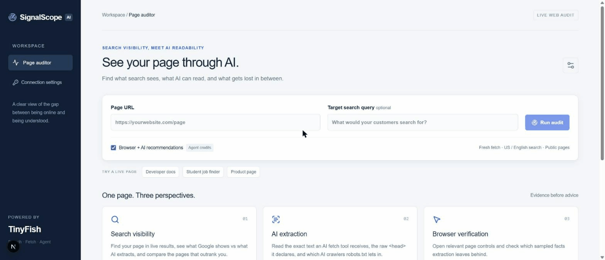

# SignalScope

**Live Demo:** [https://signalscope-tinyfish-ai.vercel.app/](https://signalscope-tinyfish-ai.vercel.app/)



so SignalScope is an SEO + AI-readability page auditor built with TinyFish AI. you give it a URL and the search query you want that page to show up for, and it checks two things at once: how the page shows up in live search, and what an AI search or fetch tool actually extracts when it reads the page. then it gives you a 0-100 AI Visibility Score, a side by side of "what Google shows vs what AI reads", and a list of fixes with the exact copy or code to paste. i built this because every SEO tool i tried gave me a mystery score and generic advice like "add more content", and none of them told me whether ChatGPT or Perplexity can even read my page, so this is the tool i wanted for my own projects.

## Features

every finding in SignalScope has four parts: the evidence it saw, why it matters, the exact fix (with suggested copy or a code snippet), and how to verify it after you ship. nothing is scored as a fail just because it couldn't be measured.

* **AI Visibility Score (0-100):** four transparent sub-scores, Search visibility (30), AI extraction (30), Metadata & structure (20), Answer-ability (20). click any group and you see every point with its evidence line. unknown checks are excluded from the denominator, not zeroed.
* **What Google shows vs what AI extracts:** the live SERP title + snippet next to the Fetch title, description and opening text, with your query terms highlighted, plus notes when they diverge ("your snippet mentions X; the extracted text never does").
* **Answer-ability passage:** finds the single passage an AI assistant would quote for your query, shows its coverage of the query terms, how far into the page it sits, and how long it is. if nothing covers 50% it tells you to write a direct answer under the H1.
* **Raw HTML `<head>` audit:** title length, meta description, robots/noindex, canonical, hreflang, Open Graph, Twitter card, JSON-LD types (and invalid JSON), `<html lang>`, viewport, H1 count and skipped heading levels.
* **AI-crawler policy:** reads `robots.txt`, `llms.txt` and `sitemap.xml` and evaluates 14 agents (GPTBot, OAI-SearchBot, ChatGPT-User, ClaudeBot, Claude-Web, anthropic-ai, PerplexityBot, Google-Extended, Googlebot, Bingbot, Applebot-Extended, Amazonbot, CCBot, Bytespider) for the exact path you audited. also checks if the sitemap lists your page and shows Cloudflare `Content-Signal` if present.
* **Competitor comparison:** fetches the top 3 organic competing results (social, forum and video domains excluded) and compares words, headings, meta description, Open Graph and answer coverage in one table, plus a SERP intent mix (how many docs / blogs / product pages / forums rank) so you know what format wins.
* **Browser verification + AI recommendations (optional):** the TinyFish Agent opens the page in a real browser, samples visible facts, and proposes up to 3 content improvements. a recommendation is only kept if its evidence quote exists verbatim in the extracted text.
* **Fix prompts:** one click copies a ready to paste prompt for your coding agent or CMS workflow, per finding or for the whole plan.
* **Save & share, before/after:** share links are stateless, the whole report is compressed into the URL fragment (nothing is uploaded). the last audit per URL is kept in your browser so a re-run shows score deltas and which findings were resolved.
* **Export:** Markdown report, findings CSV, raw evidence JSON, print to PDF.
* **Bring your own key:** add your TinyFish API key in the UI if you don't want to use the server one.

## Tech Stack

the stack is simple, Next.js for the app and API route (it streams NDJSON so you see partial results while the slower calls finish), and all the live web work is done by the TinyFish API which you can check out at [https://www.tinyfish.ai/](https://www.tinyfish.ai/).

* **Next.js 16** & **React 19**
* **TypeScript**
* **Tailwind CSS 4** (plus plain CSS for the report)
* **TinyFish API** ([https://www.tinyfish.ai/](https://www.tinyfish.ai/)) — Search, Fetch and Agent
* no database, no fixtures, every number comes from a live call made during your audit

## How TinyFish is Used

so how is TinyFish used in this project? one audit makes 7 to 8 live calls and every one of them feeds a specific part of the report (you can see each call and what it was for in the Run details tab).

### 1. TinyFish Search
Search is called three times. first with your target query to find the exact URL and its position, title and snippet (that's the search half of the side by side card and the biggest chunk of the score). second with an alternate phrasing, a question form like "how to ..." / "what is ..." when your query isn't one, or the page title, to see if the page only ranks for one wording. third with a `site:host/path` discovery query to tell an indexing problem apart from a relevance problem. the result lists are also used to classify the SERP intent mix and to pick the competitors.

### 2. TinyFish Fetch
Fetch does the heavy lifting and is called four times, always with `ttl: 0` so it's fresh. once as Markdown, which is literally what an AI tool extracts, that's where word count, headings, prose ratio and the answer passage come from. once as raw HTML (`format: "html"` with the `html` selector) so i can parse the real `<head>`: title, description, robots, canonical, OG, Twitter, JSON-LD, lang, viewport and the heading outline. once for `robots.txt`, `llms.txt` and `sitemap.xml` in a single call to build the crawler policy table. and once for the top 3 competing results in one call for the comparison table.

### 3. TinyFish Agent
and finally the Agent (optional, uses credits) opens the page in a real browser, reads it like a person, samples 3-4 visible facts with the URL they were read from, and proposes content recommendations using a strict output schema. i then verify everything it says: observations from other pages are dropped, quotes are matched against the Fetch extraction, and any recommendation whose evidence quote isn't actually on the page is rejected and counted as rejected in the report. its step by step progress streams into the UI while it runs.

## What the score means

| Range | Grade | Meaning |
| --- | --- | --- |
| 85-100 | A | AI-ready: search engines and AI tools can find, read and quote the page |
| 70-84 | B | mostly visible, a few specific gaps |
| 55-69 | C | readable but search / metadata gaps limit how often it's surfaced |
| 40-54 | D | significant extraction or visibility problems |
| 0-39 | F | fundamental blockers, AI answers won't cite this page |

the score is directional. search positions come from one TinyFish Search sample (US, English) at audit time, robots rules are evaluated for the exact path only, and HTTP headers, Search Console data and backlinks are not inspected. the "% of checks measurable" number next to the score tells you how much of it was actually observed.

## Setup & Installation

so to run this on your machine you first need to install the dependencies and configure your environment.

### Prerequisites
* Node.js 22+ installed on your machine
* A TinyFish API key (Search and Fetch are free, Agent uses credits)

### Installation Steps

1. **Clone the repository:**
   ```bash
   git clone https://github.com/Chethan-4255/signalscope_tinyfish.ai.git
   cd signalscope_tinyfish.ai
   ```

2. **Install the dependencies:**
   ```bash
   npm install
   ```

3. **Configure your API key:**
   create a `.env.local` file in the root folder and put your key in it (there's a `.env.example` to copy).
   ```bash
   TINYFISH_API_KEY=your_api_key_here
   ```
   *(Note: You can also skip this and enter your API key directly in the app's Connection settings when it's running, it stays in the tab and is only forwarded to TinyFish.)*

4. **Start the development server:**
   ```bash
   npm run dev
   ```
   open the localhost link provided in the terminal to see the app working.

5. **Other commands:**
   ```bash
   npm test        # unit tests (score, head audit, robots parser, answer passage, share links, pipeline)
   npm run build   # production build
   npm run demo    # re-collect the live evidence in demo-evidence/ (spends credits; add --deep for Agent)
   ```

### API

`POST /api/audit` with `{ "url": "...", "query": "optional target query", "deep": true|false }` streams NDJSON events (`progress`, `stage`, `extraction`, `partial`, `result`, `error`). pass your own key with an `x-tinyfish-key` (or `x-tinyfish-api-key`) header. `GET /api/health` tells you if a server key is configured.

## Demo pages

these are real pages i audited with the final pipeline, the full JSON evidence for each run is in [`demo-evidence/`](demo-evidence/).

* **TinyFish Quick Start** (`https://docs.tinyfish.ai/quick-start`, query "tinyfish quick start") — 87/100 (A). ranks #1 for both phrasings, 1,330 words extracted, llms.txt present and mentions the page, all 14 AI crawlers allowed. fixes: no body passage restates "quick start" (the H1 does), SERP snippet doesn't mention the query, no JSON-LD, 56-char meta description.
* **Firstrole** (`https://firstrole-tinyfish-ai.vercel.app/`, query "live job finder for students") — 36/100 (F). my own project: not in the top 10, only 64 words reach the extractor, best passage covers 25% of the query, no OG, no JSON-LD, no sitemap/robots. a good example of a page that looks fine in a browser but is nearly invisible to AI tools.
* **Linear pricing** (`https://linear.app/pricing`, query "linear pricing", with Agent) — see `demo-evidence/linear-pricing.json` for the score, the browser-verified facts and the AI recommendations that passed quote validation.

## Links

* **Live Demo:** [https://signalscope-tinyfish-ai.vercel.app/](https://signalscope-tinyfish-ai.vercel.app/)
* **Demo recording:** [demo-evidence/signalscope-demo.gif](demo-evidence/signalscope-demo.gif)
* **Developer:** Chethan Vasthaw Tippani
* **LinkedIn:** [https://www.linkedin.com/in/chethan-vasthaw/](https://www.linkedin.com/in/chethan-vasthaw/)
* **Portfolio:** [https://chethan-4255.github.io/Portfolio/](https://chethan-4255.github.io/Portfolio/)
* **GitHub Repository:** [chethan-4255/signalscope_tinyfish.ai](https://github.com/chethan-4255/signalscope_tinyfish.ai)
